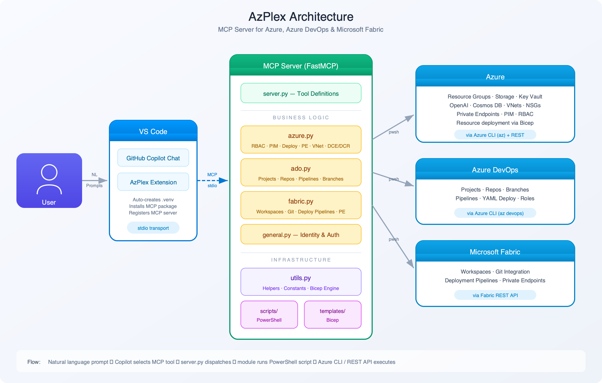

# AzPlex

[](https://marketplace.visualstudio.com/items?itemName=Siddhant.azplex)
[](https://pypi.org/project/azplex/)
[](LICENSE)

**AzPlex** is an [MCP](https://modelcontextprotocol.io/) server for **Azure**, **Azure DevOps**, and **Microsoft Fabric**. It lets you deploy, manage, and orchestrate cloud resources using natural language in VS Code with GitHub Copilot Chat.

## Install

**Option A — VS Code Extension (recommended):**

Install the [AzPlex extension](https://marketplace.visualstudio.com/items?itemName=Siddhant.azplex) from the VS Code Marketplace. It bundles the MCP server automatically.

**Option B — pip:**

```bash
pip install azplex
```

Then add to your MCP config (`.vscode/mcp.json`):

```json
{
  "servers": {
    "azplex": {
      "type": "stdio",
      "command": "python3",
      "args": ["-m", "azplex.server"]
    }
  }
}
```

## Prerequisites

- **Python 3.10+**
- **PowerShell Core (pwsh)** — [Install](https://learn.microsoft.com/en-us/powershell/scripting/install/installing-powershell)
- **Azure CLI** — [Install](https://learn.microsoft.com/en-us/cli/azure/install-azure-cli), authenticated via `az login`
- **GitHub Copilot Chat** extension in VS Code

## What It Does

**30 MCP tools** across Azure, Azure DevOps, and Microsoft Fabric — plus **50 Bicep resource types** for infrastructure deployment.

### Azure (15 tools)

| Category | Tools |
|----------|-------|
| **Auth & Account** | `azure_login`, `azure_list_subscriptions`, `azure_set_subscription`, `get_current_user`, `show_agent_instructions` |
| **Resource Info** | `azure_get_resource_info` — unified query tool (list resources/RGs, find resources, get identity, activity logs, Resource Graph KQL, raw CLI) |
| **Resource Management** | `azure_create_resource_group`, `azure_create_resource` (50 Bicep templates), `azure_modify_resource` (tags, start/stop/restart, scale, public access, local auth, VNet integration, attach NSP/diagnostics/AppInsights/DCE) |
| **Security & Identity** | `azure_list_roles` (active/eligible), `azure_assign_role` (RBAC or PIM), `azure_activate_pim_roles`, `azure_deactivate_pim_roles`, `azure_remove_role` (RBAC or PIM) |
| **Networking** | `azure_manage_pe_connection` (list/approve/reject PE connections) |

### Azure DevOps (8 tools)

| Tool | Purpose |
|------|---------|
| `ado_create_project` | Create project with initial repo |
| `ado_create_repo` | Create additional repositories |
| `ado_list` | List projects or repositories |
| `ado_manage_work_item` | Create, show, update, query, and comment on work items |
| `ado_create_branch` | Create branches from base branch |
| `ado_deploy_pipeline_yaml` | Deploy YAML templates or custom YAML to repos |
| `ado_create_pipeline` | Create pipeline from YAML in repo |
| `ado_assign_role` | Assign security group roles |

### Microsoft Fabric (7 tools)

| Tool | Purpose |
|------|---------|
| `fabric_list` | List workspaces, permissions, or managed private endpoints |
| `fabric_create_workspace` | Create workspace in a capacity |
| `fabric_assign_role` | Assign workspace roles |
| `fabric_attach_workspace_to_git` | Connect workspace to Azure DevOps Git |
| `fabric_create_deployment_pipeline` | Create Dev→Prod or Dev→UAT→Prod pipelines |
| `fabric_add_deployment_pipeline_role` | Add role to deployment pipeline |
| `fabric_create_managed_private_endpoint` | Create managed PE for secure connectivity |

### Supported Bicep Resource Types (50)

Storage Account, Key Vault, Azure OpenAI, AI Search, AI Foundry, Cosmos DB, MongoDB Cluster, Container Registry, Function App (Flex/ASP), App Service, SQL Server, SQL Database, Redis Cache, VNet, Subnet, NSG, Private Endpoint, Private DNS Zone, DNS Zone VNet Link, API Management, Azure Firewall, Firewall Policy, NAT Gateway, VPN Gateway, Front Door, WAF Policy, DDoS Protection Plan, DNS Resolver, Log Analytics, Application Insights, Container Apps Environment, Container App, Container App Job, Service Bus, Data Factory, Synapse, Fabric Capacity, Automation Account, Speech Service, Logic App, UAMI, NSP, DCE, DCR, Public IP, Log Search Alert, Document Intelligence, Content Safety, Language Service, Log Search Alert.

## Usage Examples

```
login to azure
create storage account in my-rg
list resources in my-rg
activate all my PIM roles with justification "sprint deployment"
create private endpoint for my-storage blob in my-subnet
create azure devops project named MyProject with repo MainRepo
create fabric workspace named MyWorkspace in capacity <capacity-id>
```

## Architecture



## License

[MIT](LICENSE)
